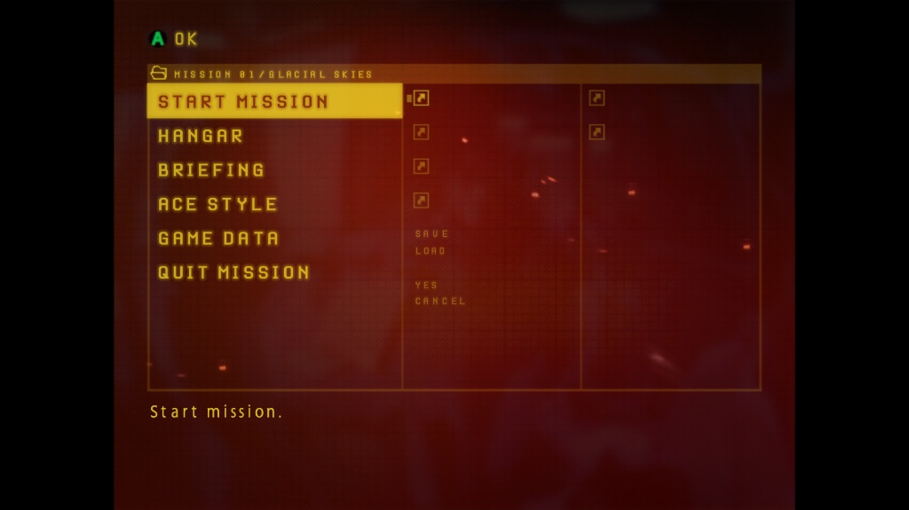
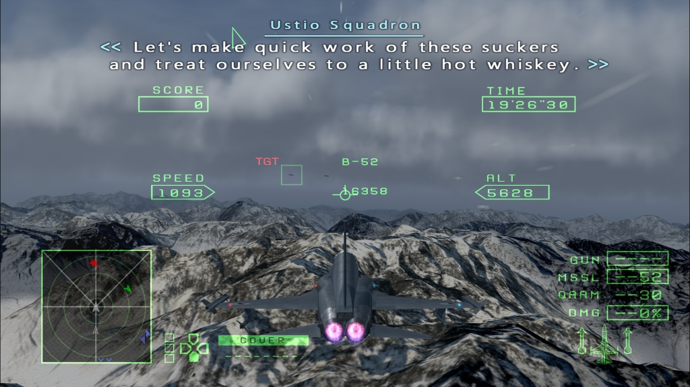

# ACZero Enhancer — Texture & Font Framework

[](https://en.cppreference.com/w/cpp/17)
[](https://microsoft.com/windows)
[](LICENSE)
[](#compatibility--disclaimer)

A modular, high-performance HD texture and font replacement framework for the **Standalone PC port** of **Ace Combat Zero: The Belkan War**.

---

## Overview

This repository hosts the core **HD Texture & Font Replacement Engine** (`acz_hdtex.dll`), the **Crash & Memory Diagnostics Module** (`memdump.dll`), the automated **Zero-Install Texture Converter & Installer** (`ACZ_Textures_installer.bat`), and an extensive suite of Python reverse engineering tools for PlayStation 2 / PC asset conversion.

> **Compatibility Note**:
> This framework has been tested **exclusively on the Standalone PC Port** version of *Ace Combat Zero: The Belkan War*.

---

## Screenshots

| In-Game Menu & Typography | In-Flight Combat HUD & Subtitles |
| :---: | :---: |
|  |  |

---

## Key Components

### 1. `acz_hdtex.dll` — HD Texture & Font Engine (v0.21)
* **Direct D3D12 Replacement**: Intercepts `GIM` and `TIM2` textures loaded into PS2 GS VRAM / D3D12 upload heaps, replacing them with 32-bit RGBA PNG assets on the fly.
* **Unified Master Font Atlases**: Replaces dynamic in-game fonts (`GameFont`) with high-resolution master font atlases (`MASTER_EN_font_32x32.png`), complete with per-glyph core centering, standard baseline height (`std_h`) alignment, and automatic subtitle bracket generation.
* **Lock-Free Render Thread**: Utilizes a 512-Kbit Bloom filter and a 64K lock-free hash table to ensure zero stutter or frame drops during gameplay.
* **TIM2 & SWAD Archive Support**: Transparently decodes and replaces textures packed inside `.swa` (`SWAD`) menu archives (`AircraftSelect.swa`, `MainSelect.swa`, `Shop.swa`) with auto-padding for non-power-of-two assets.
* **Smart Texture Dumping**: Dumps in-game textures and font atlases to disk for reverse engineering and community asset creation.

### 2. `memdump.dll` — Diagnostics & Crash Logger (v0.16)
* **Completely Independent**: Runs standalone or alongside other mods without hard dependencies.
* **Instant F2 Hotkey**: Press `F2` in-game to trigger an immediate diagnostic state report.
* **Pre-Present D3D12 Screenshot**: Performs an asynchronous GPU DMA readback directly from the swapchain backbuffer, saving an uncompressed `screenshot.png` upon crashes or exit.
* **Crash Triage**: Catches unhandled exceptions, records CPU registers and stack frames, generates standard Windows Minidumps (`acz_process.dmp`), and queries sibling modules for live VRAM and font status.
* **Automated Cleanup**: Automatically prunes diagnostic dump folders older than 24 hours on game launch.

### 3. `ACZ_Textures_installer.bat` — Portable Texture Pack Installer (v0.21)
* **Zero-Install Setup**: Runs out-of-the-box on standard Windows installations. If Python or required imaging packages are not installed, it automatically bootstraps an isolated, portable Python 3.11 runtime in `%TEMP%\ACZero_PyPortable` without modifying system environment variables.
* **Automated Asset Conversion**: Automatically extracts, crops, adjusts aspect ratios, corrects PS2-to-PC alpha channels, and generates `.json` multi-hash companion metadata for:
  * OstrichMods HUD Upgrade (`actrilogy-hud-upgrade-v1.2.1.zip`)
  * Custom aircraft icons, squadron emblems, hangar weapon diagrams, and font atlases (`custom textures.zip`).

### 4. Python Utility Suite (`py/`)
* **`ACZ_Resource_Scanner.py`**: Scans extracted `.arc` / `.fhm` containers, clusters font families (`FAMILY_*`), and generates unified multi-language master font atlases.
* **`ACZ_TIM2_Scanner.py`**: Scans binary files for `TIM2` images, decoding 4-bit, 8-bit (`CSM1`), 16-bit, and 32-bit textures into normalized PNGs + `.json`.
* **`ACZ_FHM_Converter.py`**: Recursively unpacks and repacks `.FHM` archives and metric tables.
* **`ACZ_GIM_PNG_Converter.py`**: Two-way converter for 4-bit (`PSMT4`) and 8-bit (`PSMT8`) `.gim` files with `FNV-1a` 64-bit hashing.

---

## Directory Structure

```text
├── .github/
│   └── ISSUE_TEMPLATE/            # Crash report template
├── screenshots/                    # In-game preview screenshots
├── ACZero_Enhancer.sln             # Visual Studio 2022 / 2026 Solution
├── acz_hdtex.cpp                   # C++17 HD Texture & Font Engine source
├── acz_hdtex.vcxproj               # VS Project file for acz_hdtex.dll
├── memdump.cpp                     # C++17 Crash Logger & Memory Dumper source
├── memdump.vcxproj                 # VS Project file for memdump.dll
├── build_all.bat                   # One-click x64 MSVC build script
├── CHANGELOG.md                    # Detailed version history
├── LICENSE                         # MIT License (Non-Commercial)
├── README.md                       # This file
│
├── mods/
│   ├── ACZ_Textures_installer.bat  # Portable texture installer and converter
│   ├── custom textures.zip         # Ready-to-use custom HUD & font textures
│   └── enhancer/
│       ├── acz_hdtex.ini           # Configuration for acz_hdtex.dll
│       ├── enhancer.ini            # Configuration template
│       ├── lang_en.ini             # English localization
│       ├── lang_ru.ini             # Russian localization
│       └── memdump.ini             # Configuration for memdump.dll
│
└── py/
    ├── ACZ_FHM_Converter.py        # FHM container unpacker/packer
    ├── ACZ_GIM_PNG_Converter.py    # GIM <-> PNG converter
    ├── ACZ_Resource_Scanner.py     # Font atlas scanner & clusterer
    └── ACZ_TIM2_Scanner.py         # TIM2 scanner and exporter
```

---

## Installation Guide

### Step 1: Install the Modloader
This project requires the `version.dll` (v1.2) proxy modloader to load DLL plugins from the `mods\` directory.
* Download **version.dll** from the [ACZ Enhanced Gunplay Mod (vA6.0) on ModDB](https://www.moddb.com/games/ace-combat-zero-the-belkan-war/addons/acz-enhanced-gunplay-mod).
* Place `version.dll` directly into the game root folder (next to `acz.exe`).

### Step 2: Install ACZero Enhancer
* Download the latest release (`ACZero_Enhancer_v0.21_Release.zip`) from [Releases](../../releases).
* Extract the archive directly into your game root directory (merging the `mods\` folder).

### Step 3: Install HD Textures (OstrichMods HUD Upgrade)
1. Download `actrilogy-hud-upgrade-v1.2.1.zip` from the official [OstrichMods Trilogy page](https://ostrichmods.com/trilogy.html).
2. Place the downloaded `actrilogy-hud-upgrade-v1.2.1.zip` into the `mods\` directory (do not extract it manually).
3. Run `mods\ACZ_Textures_installer.bat`. The script will automatically unpack, convert, and place all converted HUD, weapon, font, and squadron textures into `mods\textures\`.
4. Launch the game via `acz.exe`.

---

## Roadmap & Current Progress

Creating high-definition textures is an extremely labor-intensive process. Below is the current development status:

### Texture Replacement (Top Priority)
* **User Interface (HUD / UI)**: Partial (currently only assets required for OstrichMods HUD pack compatibility).
* **In-Game Fonts & Subtitles**: ~90% complete (unified master font atlases, baseline alignment, subtitle brackets).
* **Aircraft Textures & Liveries**: 0%
* **Terrain & Landmass Textures**: TBD
* **Map Objects & Buildings**: TBD
* **VFX & Particle Effects**: 0%

### Cutscenes & Cinematics
* **FMV / Cutscene HD Replacement**: TBD

---

## Contributing & Contact

Because authoring HD textures, remastering UI elements, and reversing texture formats requires significant time and effort, **community contributions are warmly welcome!**

If you want to contribute HD textures, report replacement bugs, or help with C++ / Python tool development, please reach out via:
* **GitHub Discussions**: Open a topic in the [Discussions](../../discussions) tab to showcase work-in-progress textures, share ideas, or discuss implementation details.
* **GitHub Issues**: Report crashes or bugs via [Issues](../../issues).
* **Pull Requests**: Directly submit converted textures, script improvements, or documentation updates.
* **Commentы**: Leave a comment about this on Moddb/NexusMods page and your preferred method of communication (sience comment section is not compfortable).

---

## Future Plans

The following features and expansions are planned for future development:
* **Extended Render Distance**: Increasing camera clip planes, terrain LOD thresholds, and fog distances.
* **DualSense Controller Support**: Native haptic feedback and adaptive trigger effects.
* **Quality-of-Life (QoL) Patches**: Intro skip, HUD options, and control enhancements.
* **Graphical Settings Manager**: Standalone GUI configurator for tuning graphics, texture options, and patches.
* **Widescreen Support**: Native 16:9 and 21:9 ultra-wide support across all gameplay and menu states.
* **Extended UI Elements**: Talking character radio portraits (similar to modern installments) and High-G turn indicator banners (similar to Ace Combat 6) for another mod?
* **Custom Aircraft & High-Poly Models**: Importing custom 3D aircraft meshes and high-polygon models?
* **Custom Community Localizations**: Supporting user-created language packs and full custom subtitle translations??
* **Volumetric VFX Overhaul**: Enhanced volumetric clouds, smoke trails, and atmospheric scattering???
* **Porting Framework to Ace Combat 5**: Adapting the texture engine and tools to *Ace Combat 5: The Unsung War* (leveraging their nearly identical engine architecture via static recompilation or port engine adaptation).

---

## Building from Source

### Prerequisites
* **Windows 10 / 11 (64-bit)**
* **Visual Studio 2022 or 2026** with the *Desktop development with C++* workload (MSVC v143/v144+, C++17 support).
* Windows SDK (10.0 or higher).

### One-Click Build
Run the included build script from the repository root:
```cmd
build_all.bat
```
The script locates your Visual Studio toolchain, initializes the 64-bit build environment, compiles `acz_hdtex.dll` and `memdump.dll`, and copies the binaries directly into the `mods\` folder.

### Building via Visual Studio
Open `ACZero_Enhancer.sln` in Visual Studio, select the **Release | x64** configuration, and build the solution (`Ctrl+Shift+B`).

---

## Credits & Acknowledgments

* **Mr.Hammerhed**: Project Lead, Ideologist, Creator, and Primary Tester.
* **Edelweiß**: Key contributor who made the project possible, Assistant.
* **Argon4.0 / Gemini 3.8**: AI TOOL assistant utilized for game code decompilation and reverse engineering analysis.
* **OstrichMods**: Original HUD Upgrade assets.
* **Bandai Namco Entertainment & Project Aces**: Original creators and copyright holders of *Ace Combat Zero: The Belkan War*.

---

## Non-Commercial & Free Modding Policy

This project, its source code, compiled binaries, and associated tools must always remain **100% free of charge**. 
* **No Commercial Use**: Selling, monetizing, licensing, or placing any part of this project behind paid subscription tiers or paywalls (e.g. Patreon, Boosty, Ko-fi) is strictly prohibited.
* **Respect Original Creators**: All game assets, trademarks, and titles belong to **Bandai Namco Entertainment** and **Project Aces**.
