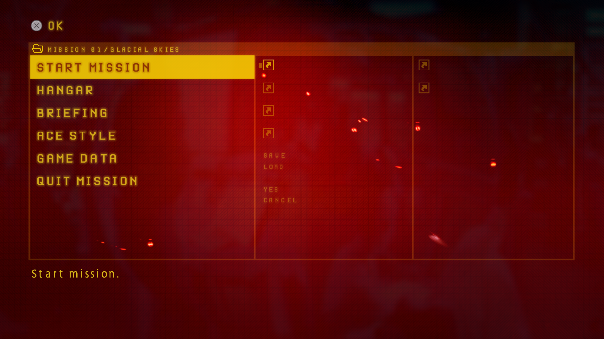
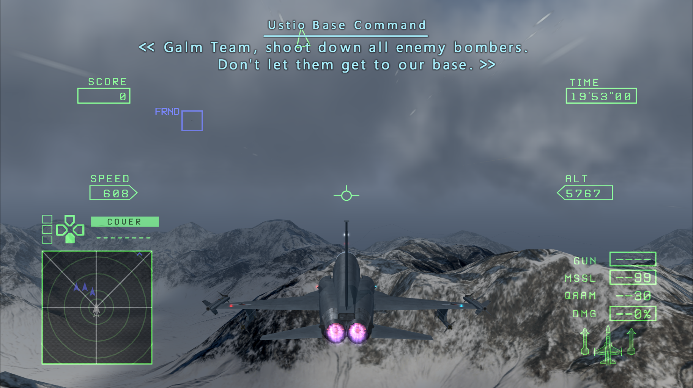

# ACZero Enhancer — Widescreen 16:9/21:9, HD Texture, Font & Input Suite (v0.23.5)

[](https://en.cppreference.com/w/cpp/17)
[](https://microsoft.com/windows)
[](LICENSE)
[](#compatibility--disclaimer)

A modular, high-performance widescreen (`16:9` & `21:9`), HD texture, font replacement, and native controller input framework for the **Standalone PC port** of **Ace Combat Zero: The Belkan War**.

---

## Overview

**ACZero Enhancer** consists of three independent C++17 DLL plugins (`enhancer.dll`, `acz_hdtex.dll`, `memdump.dll`) — with a **Built-In Native C++ Texture Pack Auto-Installer & OstrichMods Converter** (`acz_tex_installer.h`) integrated directly inside `acz_hdtex.dll` — plus a Python reverse-engineering and menu-authoring utility suite (`py/`).

> **Compatibility Note**:
> This framework has been tested **exclusively on the Standalone PC Port** version of *Ace Combat Zero: The Belkan War*, and natively supports **both** executable releases out of the box:
> * **v1.0.2.1** (`TimeDateStamp = 0x6A9E70E0`) — Initial release (separated from the AC8 bundle).
> * **v2.0.0.1** (`TimeDateStamp = 0x6AC61130`, Steam AppID `5370600`) — Official separated standalone release.
>
> All plugins (`enhancer.dll`, `acz_hdtex.dll`, and `memdump.dll`) automatically detect the running `acz.exe` version at startup and dynamically map all `.text`, `.rdata`, and `.data` RVAs (see [`docs/VERSION_MAP.md`](docs/VERSION_MAP.md) and [`acz_version_map.h`](acz_version_map.h)).

---

## Screenshots

| In-Game Menu & Typography | In-Flight Combat HUD & Subtitles |
| :---: | :---: |
|  |  |

---

## Key Components

### 1. `enhancer.dll` — Widescreen 16:9/21:9, HUD, Subtitles, Input & 60 FPS Engine (v0.23.5)
* **Full 16:9 & 21:9 Widescreen Custom Menu Engine**: Dynamically loads 16:9 and 21:9 custom menu layouts (`<menu>_16x9.swa`, `<menu>_21x9.swa`) across all 31 in-game menus with 9-slice frame scaling, edge-to-edge coverage, 21:9 `Display Settings` option (`OptionSetAspect=2`) with save persistence, and aspect-correct briefing/cutscene video playback.
* **Hor+ 21:9 3D FOV & Gameplay HUD Adaptation**: True Hor+ 3D camera FOV in 21:9 mode, unstretched 1:1 3D reticles/target boxes/compass, corner-anchored `SCORE`/`TIME`/target lists (plus 3rd-person `SPEED`/`ALT` corner anchoring), compact target labels, full-width debriefing tactical map, and uniform 12.4 subpixel X-scaling for radio/cutscene subtitles, mission title cards, and loading screen quotes.
* **DirectInput / XInput Controller & Keyboard Input Fixes**:
  * Fixes broken default DirectInput mappings so PlayStation (DualSense / DualShock 4) and standard DirectInput controllers work out-of-the-box via USB and Bluetooth (`Cross`, `Circle`, `Square`, `Triangle`, `L1`, `R1`, analog `L2`/`R2`, `Create`/`Share`, `Options`, `L3`, `R3`, `D-Pad` POV Hat, and `Touchpad Click` mapped to radar toggle), with radial stick deadzones (`16%` LS / `18%` RS) and basic rumble scaling.
  * Seamless single-player input merging (`Unlock2PlayerCampaign=0` by default) or split 2-Player Co-Op / VS Mode (`Unlock2PlayerCampaign=1`, where Player 1 is controlled by Gamepad and Player 2 independently by Keyboard).
* **60 FPS Frame-Pacing Unlocker & Memory Pool Expansion**: Disables the broken 30.0 FPS catch-up trap (`RVA +0x20BCAF`) and expands the main engine heap (`128 MB`), per-frame 3D GIF DMA stream buffer (`8 MB`), and D3D12 texture/upload pools.

### 2. `acz_hdtex.dll` — HD Texture, Font, DDS Cache & Glyph Engine (v0.23.5)
* **Autonomous BC7 / BGRA8 `.dds_cache` Engine & Direct D3D12 Replacement**: Compiles replacement PNGs to `BC7 Mode 6` and `BGRA8` `.dds_cache` files on the fly with Display P3 -> sRGB color normalization, loading HD textures directly into D3D12 with zero runtime PNG decode overhead.
* **Live Controller & Keyboard Glyph Auto-Switching (`GamepadGlyphs = AUTO | PS | XBOX | KB`)**: Automatically detects active input across PlayStation, Xbox, and Keyboard every frame and swaps all menu/HUD button prompts (`pads/`).
* **Unified Master Font Atlases**: Replaces dynamic in-game fonts (`GameFont`) with high-resolution master font atlases (`MASTER_EN_font_32x32.png`, `MASTER_EN_font_64x64.png`), complete with per-glyph core centering, standard baseline height (`std_h`) alignment, and automatic subtitle bracket generation.
* **Lock-Free Render Thread & TIM2/SWAD Support**: Uses a 512-Kbit Bloom filter and a 64K lock-free hash table to replace `GIM`, `FHM`, and `.swa` (`SWAD`) `TIM2` textures with zero stutter, including `_16x9.png` and `_21x9.png` aspect-ratio variants.

### 3. `memdump.dll` — Diagnostics & Crash Logger (v0.16.3)
* **Completely Independent**: Runs standalone or alongside other mods without hard dependencies.
* **Instant F2 Hotkey & On-Demand D3D12 Screenshot**: Press `F2` in-game to trigger an immediate diagnostic state report and pre-`Present` D3D12 backbuffer `screenshot.png`.
* **Crash Triage & Automated Cleanup**: Catches unhandled exceptions, records CPU registers and stack frames, generates standard Windows Minidumps (`acz_process.dmp`), queries sibling modules for live state, and prunes dump folders older than 24 hours on launch.

### 4. Built-In Native C++ Texture Pack Auto-Installer (`acz_tex_installer.h` inside `acz_hdtex.dll`)
* **Zero External Scripts or `.bat` Files**: Runs natively in C++ inside `acz_hdtex.dll` on startup before `ScanTexturesDirectory()`.
* **Automated Asset Conversion**: Automatically detects `actrilogy-hud-upgrade-v1.2.1.zip` and `custom textures.zip` placed in `mods\`, extracts and converts aircraft/weapon/HUD icons, corrects PS2-to-PC alpha channels, assembles 36 composite `2048x1024` hangar weapon atlases, builds `8x`/`4x` HD Master Font Atlases (`MASTER_EN_font_64x64.png`, `MASTER_EN_font_32x32.png` + `.json`), and records an `.install_stamp` so subsequent launches start instantaneously.

### 5. Python Utility Suite (`py/`)
* **`ACZ_Resource_Scanner.py` (v9)**: Scans extracted `.arc` / `.fhm` containers, clusters font families (`FAMILY_*`), and generates unified multi-language master font atlases.
* **`ACZ_TIM2_Scanner.py` (v1)**: Scans binary files for `TIM2` images, decoding 4-bit, 8-bit (`CSM1`), 16-bit, and 32-bit textures into normalized PNGs + `.json`.
* **`ACZ_FHM_Converter.py` (v5)**: Recursively unpacks and repacks `.FHM` archives and metric tables.
* **`ACZ_GIM_PNG_Converter.py` (v5)**: Two-way converter for 4-bit (`PSMT4`) and 8-bit (`PSMT8`) `.gim` files with `FNV-1a` 64-bit hashing.
* **`ACZ_SWAD_Converter.py` (v1)** & **`ACZ_SWG_Visual_Editor.py` (v1)**: Unpacker/packer, automated 16:9/21:9 menu layout generator, and interactive WYSIWYG visual editor for `.swa` / `.swg` menu archives.

---

## Installation Guide

### Step 1: Install the Modloader
This project requires the `version.dll` (v1.2) proxy modloader to load DLL plugins from the `mods\` directory.
* Download **version.dll** from the [ACZ Enhanced Gunplay Mod (vA6.0) on ModDB](https://www.moddb.com/games/ace-combat-zero-the-belkan-war/addons/acz-enhanced-gunplay-mod).
* Place `version.dll` directly into the game root folder (next to `acz.exe`).

### Step 2: Install ACZero Enhancer
* Download the latest release (`ACZero_Enhancer_v0.23.5_Release.zip`) from [Releases](../../releases).
* Extract the archive directly into your game root directory (merging the `mods\` folder).

### Step 3: Install HD Textures (OstrichMods HUD Upgrade)
1. Download `actrilogy-hud-upgrade-v1.2.1.zip` from the official [OstrichMods Trilogy page](https://ostrichmods.com/trilogy.html).
2. Place the downloaded `actrilogy-hud-upgrade-v1.2.1.zip` and `custom textures.zip` directly into the `mods\` directory (do not extract it manually).
3. Launch the game via `acz.exe`. On first startup, `acz_hdtex.dll` will automatically unpack, convert, and install all HUD, weapon, font, and squadron textures into `mods\textures\` and prebuild the `.dds_cache`.

---

## Roadmap & Current Progress

Creating high-definition textures is an extremely labor-intensive process. Below is the current development status:

### Texture Replacement (Top Priority)
* **User Interface (HUD / UI)**: ~90%.
* **In-Game Fonts & Subtitles**: ~90% complete (unified master font atlases, baseline alignment, subtitle brackets).
* **Aircraft Textures & Liveries**: 0%
* **Terrain & Landmass Textures**: TBD
* **Map Objects & Buildings**: TBD
* **VFX & Particle Effects**: 0%

---

## Contributing & Contact

Because authoring HD textures, remastering UI elements, and reversing texture formats requires significant time and effort, **community contributions are warmly welcome!**

If you want to contribute HD textures, report replacement bugs, or help with C++ / Python tool development, please reach out via:
* **GitHub Discussions**: Open a topic in the [Discussions](../../discussions) tab to showcase work-in-progress textures, share ideas, or discuss implementation details.
* **GitHub Issues**: Report crashes or bugs via [Issues](../../issues).
* **Pull Requests**: Directly submit converted textures, script improvements, or documentation updates.
* **Comments**: Leave a comment about this on Moddb/NexusMods page and your preferred method of communication (sience comment section is not compfortable).

---

## Future Plans

The following features and expansions are planned for future development:
* **Extended Render Distance**: Increasing camera clip planes, terrain LOD thresholds, and fog distances.
* **DualSense Controller Support**: Native haptic feedback and adaptive trigger effects.
* **Quality-of-Life (QoL) Patches**: Intro skip, HUD options, and control enhancements.
* **Graphical Settings Manager**: Standalone GUI configurator for tuning graphics, texture options, and patches.
* **Extended UI Elements**: Talking character radio portraits (similar to modern installments) and High-G turn indicator banners (similar to Ace Combat 6) for another mod?
* **Custom Aircraft & High-Poly Models**: Importing custom 3D aircraft meshes and high-polygon models?
* **Custom Community Localizations**: Supporting user-created language packs and full custom subtitle translations??
* **Volumetric VFX Overhaul**: Enhanced volumetric clouds, smoke trails, and atmospheric scattering???
* **Porting Framework to Ace Combat 5**: Adapting the texture engine and tools to *Ace Combat 5: The Unsung War* (leveraging their nearly identical engine architecture via static recompilation or port engine adaptation).

---

## Building from Source

### Prerequisites
* **Windows 10 / 11 (64-bit)**
* **Visual Studio 2022 or 2026** with the *Desktop development with C++* workload (MSVC v143/v144+, C++17 support).
* Windows SDK (10.0 or higher).

### One-Click Build
Run the included build script from the repository root:
```cmd
build_all.bat
```
The script locates your Visual Studio toolchain, initializes the 64-bit build environment, compiles `enhancer.dll`, `acz_hdtex.dll`, and `memdump.dll`, and copies the binaries directly into the `mods\` folder.

### Building via Visual Studio
Open `ACZero_Enhancer.sln` in Visual Studio, select the **Release | x64** configuration, and build the solution (`Ctrl+Shift+B`).

---

## Credits & Acknowledgments

* **Mr.Hammerhed**: Project Lead, Ideologist, Creator, and Primary Tester.
* **Edelweiß**: Key contributor who made the project possible, Assistant.
* **Argon4.0 / Gemini 3.8**: AI TOOL assistant utilized for game code decompilation and reverse engineering analysis.
* **OstrichMods**: Original HUD Upgrade assets.
* **Bandai Namco Entertainment & Project Aces**: Original creators and copyright holders of *Ace Combat Zero: The Belkan War*.

---

## Non-Commercial & Free Modding Policy

This project, its source code, compiled binaries, and associated tools must always remain **100% free of charge**.
* **No Commercial Use**: Selling, monetizing, licensing, or placing any part of this project behind paid subscription tiers or paywalls (e.g. Patreon, Boosty, Ko-fi) is strictly prohibited.
* **Respect Original Creators**: All game assets, trademarks, and titles belong to **Bandai Namco Entertainment** and **Project Aces**.
